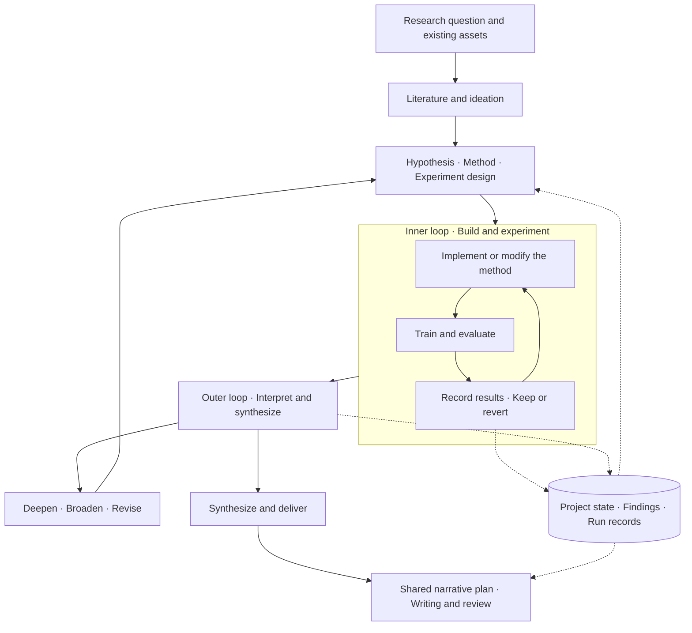

<p align="center"><a href="https://yichen-zju.github.io/lemvo/"></a></p>

<h1 align="center">Lemvo</h1>
<p align="center"><strong>A research agent that thinks and acts.</strong><br>One research system. Two CLI engines.</p>

<p align="center"><strong>English</strong> · <a href="README.zh-CN.md">简体中文</a></p>
<p align="center">
  <a href="https://yichen-zju.github.io/lemvo/?lang=en">Website</a> ·
  <a href="#quickstart">Quickstart</a> ·
  <a href="#run-modes">Run modes</a> ·
  <a href="https://github.com/Yichen-ZJU/lemvo/stargazers">Star Lemvo ↗</a>
</p>

<p align="center">
  
  
  
  
</p>

**Lemvo connects research reasoning with action.** Understand a question, investigate the literature, build methods, choose experiments, and learn what to do next. Research Orchestrator coordinates **114 research skills** across Claude Code and Codex CLI, carrying ideas into findings and findings into papers.

Start from a research direction, an existing paper and implementation, or unfinished experiments. Lemvo chooses a route from your goal and available assets: literature and ideation, reproduction and improvement, or a standalone autonomous experiment package. Work together at key decisions, or let the resident controller continue within your authorized scope.

## Core capabilities

| Capability | How it advances research | Entry points |
|---|---|---|
| **Research orchestration** | Connect literature, hypotheses, methods, experiments, and writing; choose the next direction from the results | [Research Orchestrator](claude/skills/research-orchestrator/SKILL.md) |
| **Full-text research and ideation** | Map the field, investigate primary evidence, and turn reusable methods and mechanisms into candidate designs | [Deep Research](claude/skills/deep-research/SKILL.md) · [Grounded Ideation](claude/skills/shared-references/grounded-ideation.md) |
| **Method development and autonomous experiments** | Iterate on existing code or forge a Karpathy-style task package; modify, measure, keep, or revert | [Experiment Forge](claude/skills/experiment-forge/SKILL.md) · [Autoresearch](claude/skills/autoresearch/SKILL.md) |
| **Result-driven reflection** | Turn observations into method changes and the next experiment, preserving useful signals and their scope | [Research Orchestrator](codex/skills/research-orchestrator/SKILL.md) |
| **Scientific narrative and paper production** | Align the abstract, introduction, sections, figures, and conclusion, then connect drafting, citations, and review | [Paper Narrative](claude/skills/paper-narrative/SKILL.md) · [Paper Production](claude/skills/paper-production/SKILL.md) |
| **Continuity and human guidance** | Save project state, resume work, wait for experiments, and switch between guided and unattended modes | [Run modes](#run-modes) |

## One workflow, two nested loops

**The inner loop advances experiments. The outer loop advances understanding.** Build and test methods inside; interpret the findings and revise hypotheses outside. When a contribution takes shape, writing connects the question, insight, method, and evidence into one scientific story.



Join the workflow from the progress you already have: runnable code leads into experiments, existing results lead into analysis and revision, and a mature contribution leads into writing. Research and ideation expand as the task requires.

## From literature to an actionable idea

Literature research supports both **understanding the field** and **building the method**:

- **Breadth:** compare problem definitions, approaches, disagreements, and unresolved gaps.
- **Depth:** retrieve full text through ArXiv MCP, search the evidence, and preserve paper versions and sources for the claims that matter.
- **Transfer:** extract usable baselines, implementations, and mechanisms; specify what to adopt, where to change it, and why it might help.
- **Ideation:** connect a gap with a mechanism to form a testable proposal. Expand across domains when useful; mechanism fit guides the choice.

Complementary existing methods can form a candidate too: explain the complementarity and use A, B, and A+B comparisons to examine the added value. Results feed the next round of ideation, with observations, predictions, and explanations kept distinct.

Related skills: [Literature Review](claude/skills/literature-review/SKILL.md) · [Brainstorming](claude/skills/brainstorming-research-ideas/SKILL.md) · [Creative Thinking](claude/skills/creative-thinking-for-research/SKILL.md) · [Idea Evaluator](claude/skills/idea-evaluator/SKILL.md)

## Make every experiment answer a research question

Orchestrator chooses the experimental route for the task:

| Starting point | Approach | Typical outputs |
|---|---|---|
| An existing model and codebase | Reproduce a baseline and iterate on its methods and training recipe | Baseline, candidate changes, measurements, and improvement records |
| A question and a hypothesis | Build an implementation, run a small real probe, and revise from observations | Runnable method, diagnostic findings, and next design |
| A standalone autonomous experiment | **Experiment Forge** builds the package; **Autoresearch** performs the iteration | Fixed evaluation, editable code, run instructions, and experiment ledger |
| Existing experiments and records | Read the original project state and continue the analysis or experiment loop | Continued progress and cumulative resource records |

**Experiment Forge** delivers a Karpathy-style self-running task package: goal, evaluation contract, editable files, dependencies, and run instructions. **Autoresearch** runs the modify → measure → keep/revert inner loop in that package or an existing implementation, improving accuracy, loss, or efficiency while leaving results for the outer loop to interpret.

Exploratory experiments guide development; confirmatory experiments support paper claims. Measurement and implementation problems are handled where they occur. Negative results retain their tested conditions and scope, useful positive signals remain available for development, and diagnostics connect to concrete method decisions.

<details>
<summary>A simple example: improve a handwritten-digit classifier</summary>

1. **Frame the question:** improve the robustness of an existing classifier.
2. **Read and propose:** investigate relevant methods and select a training or model change worth trying.
3. **Establish a baseline:** run the implementation and choose the measurements and comparisons.
4. **Iterate inside:** modify, train, evaluate, retain useful changes, and record unsuccessful attempts.
5. **Reflect outside:** identify which errors improved and which remain; refine the hypothesis and return to experimentation.
6. **Develop the contribution:** use appropriate controls and analyses, then organize code, findings, and evidence into a paper.

A project may pass through both loops many times: every experiment leaves a result, and every reflection chooses the next action.

</details>

## Paper Narrative: a coherent scientific story

Writing starts from **the contribution and its evidence**. Paper Narrative establishes one lightweight shared plan connecting the central question, gap, insight, method, and findings. The abstract, introduction, body, figure order, and conclusion follow that plan and evolve with the discoveries.

| Writing stage | How Lemvo organizes it |
|---|---|
| **Abstract** | Condense the problem, insight, method, and central finding so readers understand the contribution quickly |
| **Introduction** | Establish the motivation, explain the gap in current understanding, and show why the approach follows |
| **Sections and figures** | Give each section an argumentative purpose and each figure a claim to support |
| **Conclusion** | Answer the opening question and leave the reader with the new understanding and its significance |
| **Production and review** | Connect scientific figures, citation checks, structural review, and writing review to manuscript delivery |

Six narrative perspectives can be selected and combined: **root causes, counter-intuitive reframing, theory explaining practice, benchmarks exposing failure, practical and societal value, and unifying principles**. Efficiency studies, theory papers, benchmarks, and method papers can use structures suited to their own evidence.

Related skills: [Paper Narrative](claude/skills/paper-narrative/SKILL.md) · [Intro Drafter](claude/skills/intro-drafter/SKILL.md) · [Paper Writing](claude/skills/paper-writing/SKILL.md) · [Figure Composer](claude/skills/figure-composer/SKILL.md) · [Pre-submission Reviewer](claude/skills/pre-submission-reviewer/SKILL.md)

## 114 research skills

The same **114 skill names** are adapted for both CLIs, spanning research workflows and specialist methods. Engine implementations live in [`claude/`](claude/) and [`codex/`](codex/), with tool use, agent collaboration, and configuration adapted to each host.

| Topic | Count | Examples |
|---|---:|---|
| Research and literature | 12 | research-orchestrator · deep-research · literature-review · idea-evaluator |
| Experiment workflows | 8 | experiment-forge · autoresearch · replication · experiment-queue |
| Papers and writing | 13 | paper-narrative · paper-production · intro-drafter · ml-paper-writing |
| Review and disclosure | 7 | research-review · paper-code-audit · pre-submission-reviewer |
| Biology and molecules | 15 | alphafold2 · boltz · proteinmpnn · scvi-tools |
| Training, tuning, and alignment | 13 | deepspeed · peft · unsloth · grpo-rl-training |
| Multimodal models | 6 | clip · llava · whisper · segment-anything |
| Architectures and efficiency | 11 | flash-attention · knowledge-distillation · model-pruning · awq |
| Mechanistic interpretability | 2 | transformer-lens · saelens |
| Scientific figures | 3 | academic-plotting · figure-style · figure-composer |
| Evaluation | 2 | lm-evaluation-harness · nemo-evaluator |
| Compute, tracking, and workspace | 22 | compute-env-setup · remote-compute-ssh · weights-and-biases · session-log |

These 12 topic groups organize the catalogue for browsing. Counts come from each engine's `skills/<name>/SKILL.md` files. Explore [Claude skills](claude/skills/), [Codex skills](codex/skills/), or the [interactive directory](https://yichen-zju.github.io/lemvo/?lang=en#skills).

<a id="quickstart"></a>
## Quickstart

Install and sign in to Claude Code or Codex CLI first. Run the commands below in **Bash on Linux / WSL2**. Choose an engine, or install both separately.

<details open>
<summary><strong>Claude Code</strong></summary>

```bash
git clone https://github.com/Yichen-ZJU/lemvo.git
cd lemvo/claude
bash install.sh
```

Installs skills, specialist agents, and `~/.claude/CLAUDE.md`, backing up matching files. Use `bash install.sh --with-mcp` for paper-retrieval configuration, or configure ArXiv MCP below.

</details>

<details>
<summary><strong>Codex CLI</strong></summary>

```bash
git clone https://github.com/Yichen-ZJU/lemvo.git
cd lemvo/codex
bash setup.sh install
```

Installs skills and `~/.codex/AGENTS.md`, backing up matching files. Registers ArXiv MCP when its executable and Codex configuration are available.

</details>

Open `claude` or `codex` in your project folder and describe the goal:

> I want to research X.

Or start from existing work:

> Reproduce this paper from the code here, then improve the method. Confirm each experimental plan with me first.
>
> Continue this project, analyze the existing results, and advance the next experiments autonomously. Preserve each round's findings and changes.

Lemvo calls Research Orchestrator to clarify the goal and available resources, create `research-state.yaml`, and coordinate the two loops. Existing projects resume from their saved state.

### Set up ArXiv MCP full-text retrieval

Install [uv](https://docs.astral.sh/uv/getting-started/installation/), then run:

```bash
uv tool install arxiv-mcp-server
```

For Claude Code:

```bash
claude mcp add --scope user arxiv -- "$HOME/.local/bin/arxiv-mcp-server"
```

For Codex CLI, start and sign in once to create its configuration, then run from `lemvo/codex/`:

```bash
bash scripts/register-arxiv-mcp.sh
```

Restart the CLI and check that the arxiv tools loaded. For a custom executable path, pass `ARXIV_MCP_SERVER` to the Codex registration script or use the actual path in the Claude registration command.

<a id="run-modes"></a>
## Guided and unattended, with switching as you go

| Mode | How work advances | Best fit |
|---|---|---|
| **Guided** | Reports at major stage handoffs and waits for confirmation or guidance; authorized experiment batches run autonomously | Explore together and review key decisions |
| **Unattended** | The resident controller connects research, ideation, experiments, analysis, and revision, continuing when jobs finish | Continuous progress toward a clear goal |

Both modes share project state, findings, results, and cumulative resource records. Switches take effect at safe handoffs while running training continues. Submit guidance, adjust direction, or switch back to guided at any point.

In an interactive session, state your preference: “confirm each experiment with me first” or “run autonomously, come back when stuck.” **Cross-turn unattended work uses the resident `lemvo-run.sh` controller**. Initialize the project interactively, stop the current interactive execution, and then start the controller.

<details>
<summary><strong>Start, switch modes, and submit guidance</strong></summary>

Run from an initialized project folder and select your installed engine:

```bash
# Claude Code
ENGINE=claude
RUN="$HOME/.claude/skills/research-orchestrator/templates/lemvo-run.sh"

# For Codex CLI instead:
# ENGINE=codex
# RUN="$HOME/.codex/skills/research-orchestrator/templates/lemvo-run.sh"

# Use --mode guided to start in guided mode
nohup bash "$RUN" start "$PWD" --engine "$ENGINE" --mode unattended \
  > lemvo-controller.log 2>&1 &

bash "$RUN" status "$PWD"
bash "$RUN" switch "$PWD" guided
bash "$RUN" advance "$PWD"
bash "$RUN" switch "$PWD" unattended

# Queue a guidance file for the next turn
bash "$RUN" steer "$PWD" /path/to/guidance.md
```

The controller reads the project's mode and resumes the engine. It observes registered background experiments through ordinary code, **without additional model calls while waiting**. When a job ends, its result receipt goes to the engine for analysis. State is stored in the project folder, and `status` reports the current wait or pause reason.

GPU hours and model costs are tracked by default. Explicitly authorized caps, preparation-stall decisions, and configured runner turn limits apply when set. A pause preserves existing progress for continuation.

Implementation: [Claude controller](claude/skills/research-orchestrator/templates/lemvo-run.sh) · [Codex controller](codex/skills/research-orchestrator/templates/lemvo-run.sh)

</details>

## Repository layout and project memory

```text
lemvo/
├── README.md                English project guide
├── README.zh-CN.md          Chinese project guide
├── assets/                  Shared brand assets
├── claude/                  Claude Code implementation
│   ├── install.sh
│   ├── CLAUDE.md
│   ├── agents/
│   └── skills/
└── codex/                   Codex CLI implementation
    ├── setup.sh
    ├── AGENTS.md
    └── skills/
```

Research state and outputs live in **your project folder**: `research-state.yaml` records the campaign state; findings, experiment logs, and result files feed subsequent analysis; narrative plans in `outputs/.plans/` align the paper. The resident controller also tracks jobs, turns, guidance, and receipts so the next turn builds on the existing work.

To update, run `git pull` in your clone and rerun the installer for your engine. Backup and recovery details: [Claude installation notes](claude/README.md#安装说明--install-notes) · [Codex installation notes](codex/README.md#安装说明--install-notes).

## License

Original content is released under MIT; see the [Claude license](claude/LICENSE) and [Codex license](codex/LICENSE). Third-party components retain their own licenses. The vendored ARS in `academic-research-suite` (© Cheng-I Wu) is **CC BY-NC 4.0**, for non-commercial use; see the component's license files for details.

<sub>Thanks to [autoresearch](https://github.com/karpathy/autoresearch), [Feynman](https://github.com/Companion-Inc/feynman), and [AI Research Skills](https://github.com/Orchestra-Research/AI-Research-SKILLs). Further sources are documented in the engine directories and component files.</sub>
