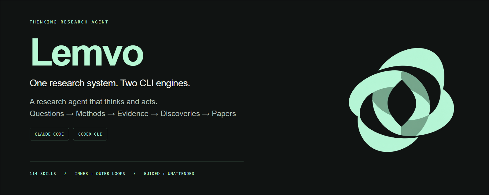
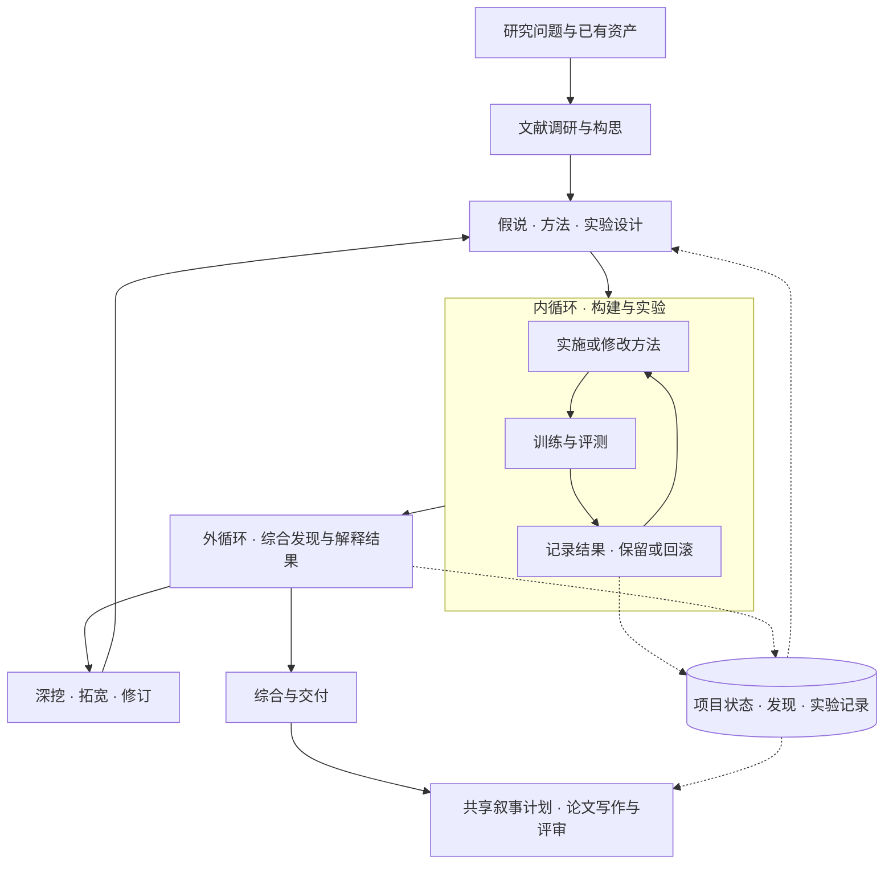

<p align="center"><a href="https://yichen-zju.github.io/lemvo/"></a></p>

<h1 align="center">Lemvo</h1>
<p align="center"><strong>会思考、会行动的科研 Agent。</strong><br>A research agent that thinks and acts.<br>One research system. Two CLI engines.</p>

<p align="center">
  <a href="https://yichen-zju.github.io/lemvo/?lang=zh">项目主页</a> ·
  <a href="https://yichen-zju.github.io/lemvo/?lang=en">Website</a> ·
  <a href="#quickstart">快速开始</a> ·
  <a href="#run-modes">运行模式</a> ·
  <a href="#english">English</a> ·
  <a href="https://github.com/Yichen-ZJU/lemvo/stargazers">Star Lemvo ↗</a>
</p>

<p align="center">
  
  
  
  
</p>

**Lemvo 将研究思考与实际行动接在一起。** 理解问题、读透文献、构建方法、选择实验，并根据结果修订下一步。Research Orchestrator 协调 **114 个科研技能**，让 Claude Code 与 Codex CLI 推进从构想到发现、再到论文的研究过程。

从一个研究方向开始，也可以从已有论文、代码或实验结果接续。Lemvo 会根据目标与现有资产选择路线：调研构思、复现并改进已有方法，或构建可独立运行的实验任务包。你可以在关键节点参与，也可以让常驻控制器在授权范围内持续推进。

## 核心能力

| 能力 | 它如何推进研究 | 主要入口 |
|---|---|---|
| **自主科研编排** | 连接文献、假说、方法、实验和写作；根据结果选择深挖、拓宽、修订或收尾 | [Research Orchestrator](claude/skills/research-orchestrator/SKILL.md) |
| **全文文献调研与构思** | 广度扫描研究版图，深入原文核对关键结论；把可复用方法和机制转化为候选方案 | [Deep Research](claude/skills/deep-research/SKILL.md) · [Grounded Ideation](claude/skills/shared-references/grounded-ideation.md) |
| **方法建设与自动实验** | 从已有代码迭代，或锻造 Karpathy 式自驱任务包；执行修改、测量、保留与回滚 | [Experiment Forge](claude/skills/experiment-forge/SKILL.md) · [Autoresearch](claude/skills/autoresearch/SKILL.md) |
| **结果驱动的外循环** | 将发现落实为下一步方法改动和实验设计，保留正信号、负结果及其适用范围 | [Research Orchestrator](codex/skills/research-orchestrator/SKILL.md) |
| **论文叙事与总装** | 用共享叙事计划组织摘要、Introduction、章节、图序和结尾，再连接绘图、引用核验与评审 | [Paper Narrative](claude/skills/paper-narrative/SKILL.md) · [Paper Production](claude/skills/paper-production/SKILL.md) |
| **持续推进与人工介入** | 保存项目状态，续接会话，等待后台实验；半自动与全自动共用结果和记录，随时切换 | [运行模式](#run-modes) |

## 一套流程，两层循环

**内循环推进实验，外循环推进认识。** 内循环构建并测试方法；外循环解释结果、更新假说，决定接下来值得做什么。写作从已经形成的发现出发，将问题、洞察、方法和证据组织成同一条主线。



研究可以从任意已有进展接入：有可跑代码时进入实验；有结果时进入分析与修订；有成熟贡献时进入写作。调研和构思按任务需要展开。

## 从文献到可执行的 Idea

文献调研同时服务于**理解领域**和**建设方法**：

- **广度**：比较问题定义、方法谱系、研究分歧与尚未解决的缺口。
- **深度**：通过 ArXiv MCP 下载全文、搜索文内证据，保留论文版本和关键结论的来源。
- **迁移**：提取可采用的基线、可复用的实现和可迁移机制，说明具体搬什么、改哪里、为何可能有效。
- **构思**：把缺口与机制连接成可检验提案；需要时扩展跨领域检索，选择依据是机制是否契合问题。

已有方法的互补组合也可以成为候选：写清互补理由，用 A、B 与 A+B 对照检验新增价值。结果回流到下一轮构思，已有观测、预测和待检验解释各有位置。

相关技能：[Literature Review](claude/skills/literature-review/SKILL.md) · [Brainstorming](claude/skills/brainstorming-research-ideas/SKILL.md) · [Creative Thinking](claude/skills/creative-thinking-for-research/SKILL.md) · [Idea Evaluator](claude/skills/idea-evaluator/SKILL.md)

## 让每次实验回答一个研究问题

Orchestrator 根据课题选择实验路线：

| 起点 | 工作方式 | 典型产出 |
|---|---|---|
| 已有模型与代码 | 复现基线，在现有实现上迭代方法与训练配方 | 基线、候选改动、评测结果与改进记录 |
| 已有问题与假说 | 构建方法，运行最小真实实验，再根据观测修订 | 可跑实现、诊断结果与下一步方法设计 |
| 需要独立交付的自驱实验 | **Experiment Forge** 锻造任务包，**Autoresearch** 执行自动迭代 | 固定评测、可修改代码、运行指令与实验台账 |
| 已有实验与记录 | 读取原项目状态与结果，续跑分析或实验循环 | 延续已有进展与累计资源记录 |

**Experiment Forge** 交付的是 Karpathy 式的自驱任务包：研究目标、评测契约、可编辑文件、依赖与运行指令一并就绪。**Autoresearch** 在这个包或已有代码中执行“改 → 测 → 留 / 回滚”的内循环，优化正确率、损失或效率，也为外循环留下可分析的结果。

探索与确认各有用途：开发实验帮助建设方法，确认实验支撑论文结论。测量和实现问题先在对应层面处理；一次负结果保留其测试条件与范围，已有正信号继续作为开发依据。诊断产出应连接到具体的方法决策。

<details>
<summary>一个简单例子：改进手写数字分类器</summary>

1. **提出问题**：希望改善一个已有分类器的鲁棒性。
2. **调研与构思**：阅读相关方法，找出一个可尝试的训练或模型改动。
3. **建立基线**：跑通已有实现，确定要观察的指标与对照。
4. **内循环**：修改方法、训练、评测，保存有效改动并记录未奏效的尝试。
5. **外循环**：分析哪些错误减少、哪些仍在；据此提出更具体的假说，修订方法并回到实验。
6. **形成贡献**：用相应对照与分析建立贡献的证据，把代码、结果和发现组织成论文。

同一个课题可以经历多次内外循环：每轮实验留下结果，每轮反思选择下一步。

</details>

## Paper Narrative：让发现成为一篇有主线的论文

写作由**核心贡献和证据**驱动。Paper Narrative 建立一份共享的轻量叙事计划，连接论文中的核心问题、现有缺口、关键洞察、方法设计与结果。摘要、Introduction、正文、图序和结尾沿用同一条主线，并随发现更新。

| 写作环节 | Lemvo 如何组织 |
|---|---|
| **摘要** | 凝练问题、关键洞察、方法与核心发现，让读者迅速理解贡献 |
| **Introduction** | 从具体问题建立研究动机，解释现有认识的缺口与方案的必要性 |
| **正文与图序** | 每个章节推进一个论证功能，每张图支撑相应主张 |
| **Conclusion** | 回答开篇问题，明确已建立的新认识及其意义 |
| **总装与评审** | 衔接科研绘图、引用核验、结构审查与写作评审，完成稿件交付 |

六种叙事视角可按贡献选择与组合：**根因定位、反直觉重构、理论解释经验、基准暴露失效、现实应用价值、极简统一**。纯效率改进、理论稿、基准稿和方法稿都可以采用适合自身证据的组织方式。

相关技能：[Paper Narrative](claude/skills/paper-narrative/SKILL.md) · [Intro Drafter](claude/skills/intro-drafter/SKILL.md) · [Paper Writing](claude/skills/paper-writing/SKILL.md) · [Figure Composer](claude/skills/figure-composer/SKILL.md) · [Pre-submission Reviewer](claude/skills/pre-submission-reviewer/SKILL.md)

## 114 个科研技能

同一套 **114 个技能名称**分别适配两种 CLI，覆盖科研流程和领域方法。两端实现保存在 [`claude/`](claude/) 与 [`codex/`](codex/)，工具调用、代理协作和配置按宿主适配。

| 主题 | 数量 | 代表技能 |
|---|---:|---|
| 研究设计与文献 | 12 | research-orchestrator · deep-research · literature-review · idea-evaluator |
| 实验闭环 | 8 | experiment-forge · autoresearch · replication · experiment-queue |
| 论文与学术表达 | 13 | paper-narrative · paper-production · intro-drafter · ml-paper-writing |
| 评审与披露 | 7 | research-review · paper-code-audit · pre-submission-reviewer |
| 生物与分子模型 | 15 | alphafold2 · boltz · proteinmpnn · scvi-tools |
| 训练、微调与对齐 | 13 | deepspeed · peft · unsloth · grpo-rl-training |
| 多模态模型 | 6 | clip · llava · whisper · segment-anything |
| 模型架构与训练优化 | 11 | flash-attention · knowledge-distillation · model-pruning · awq |
| 机制可解释性 | 2 | transformer-lens · saelens |
| 科研图表 | 3 | academic-plotting · figure-style · figure-composer |
| 评测 | 2 | lm-evaluation-harness · nemo-evaluator |
| 算力、追踪与研究管理 | 22 | compute-env-setup · remote-compute-ssh · weights-and-biases · session-log |

12 组是方便浏览的主题分类；数量分别依据两端 `skills/<name>/SKILL.md` 计数。完整列表：[Claude 技能](claude/skills/) · [Codex 技能](codex/skills/) · [主页交互式技能目录](https://yichen-zju.github.io/lemvo/?lang=zh#skills)

<a id="quickstart"></a>
## 快速开始

先安装并登录所选的 Claude Code 或 Codex CLI。以下在 **Linux / WSL2 的 Bash** 中运行，任选一端，也可以分别安装两端。

<details open>
<summary><strong>Claude Code</strong></summary>

```bash
git clone https://github.com/Yichen-ZJU/lemvo.git
cd lemvo/claude
bash install.sh
```

安装技能、专业代理与 `~/.claude/CLAUDE.md`，同名原件自动备份。配置论文检索可使用 `bash install.sh --with-mcp`，或按下方手动配置 ArXiv MCP。

</details>

<details>
<summary><strong>Codex CLI</strong></summary>

```bash
git clone https://github.com/Yichen-ZJU/lemvo.git
cd lemvo/codex
bash setup.sh install
```

安装技能与 `~/.codex/AGENTS.md`，同名原件自动备份；已有可用 ArXiv MCP 程序与 Codex 配置时注册检索服务。

</details>

然后在你的项目目录打开 `claude` 或 `codex`，说出研究目标：

> 我要研究 X 方向。

也可以从已有资产出发：

> 这篇论文的代码在这里，先跑通基线，再尝试改进方法。每个实验方案先给我确认。
>
> 继续这个项目，自主分析已有结果并推进下一轮实验，保留每轮的发现和改动。

Lemvo 会调用 Research Orchestrator，梳理目标与可用资源、建立 `research-state.yaml`，开始双循环；已有项目则读取原状态接续。

### 配置 ArXiv MCP 全文检索

安装 [uv](https://docs.astral.sh/uv/getting-started/installation/) 后运行：

```bash
uv tool install arxiv-mcp-server
```

Claude Code：

```bash
claude mcp add --scope user arxiv -- "$HOME/.local/bin/arxiv-mcp-server"
```

Codex CLI：先启动并登录一次以生成配置，再从 `lemvo/codex/` 目录运行：

```bash
bash scripts/register-arxiv-mcp.sh
```

重启 CLI，确认 arxiv 工具已加载。自定义工具安装路径可通过 `ARXIV_MCP_SERVER` 传给 Codex 注册脚本；Claude 注册命令使用对应的实际路径。

<a id="run-modes"></a>
## 半自动与全自动，随时切换

| 模式 | 推进方式 | 适合的工作节奏 |
|---|---|---|
| **半自动 · guided** | 在主要阶段交接点汇报，等你确认或 steer；已授权的实验批次自主完成 | 共同探索方向，亲自把握关键决策 |
| **全自动 · unattended** | 常驻控制器衔接调研、构思、实验、分析和修订，实验完成后继续下一轮 | 目标明确，希望研究跨会话持续推进 |

两种模式共享项目状态、结果、发现与累计资源记录。切换在安全交接点生效，在跑训练继续执行。你可以随时提交指导、调整方向或切回半自动。

交互式入口只需说明偏好：“每个实验先给我确认”或“自主推进，卡住再找我”。**跨轮次无人值守使用 `lemvo-run.sh` 常驻控制器**：先在项目目录完成初始化，结束当前交互执行，再启动控制器。

<details>
<summary><strong>启动、切换与提交指导</strong></summary>

在已经初始化的研究项目目录运行，选择已安装的引擎：

```bash
# Claude Code
ENGINE=claude
RUN="$HOME/.claude/skills/research-orchestrator/templates/lemvo-run.sh"

# 若使用 Codex CLI，改为：
# ENGINE=codex
# RUN="$HOME/.codex/skills/research-orchestrator/templates/lemvo-run.sh"

# --mode guided 可从半自动开始
nohup bash "$RUN" start "$PWD" --engine "$ENGINE" --mode unattended \
  > lemvo-controller.log 2>&1 &

bash "$RUN" status "$PWD"
bash "$RUN" switch "$PWD" guided
bash "$RUN" advance "$PWD"
bash "$RUN" switch "$PWD" unattended

# 将指导文件加入队列，下轮读取
bash "$RUN" steer "$PWD" /path/to/guidance.md
```

控制器读取项目内的运行模式并续接引擎。等待已登记的后台实验时由普通程序观察，**不额外调用模型**；作业结束后将结果回执交给引擎分析。状态保存在项目目录，`status` 可查看当前等待或暂停原因。

GPU 小时与模型费用默认用于统计；用户明确授权的限额、准备停滞决策点和运行器轮数上限按配置执行。暂停保留已有进展，继续时无需重开课题。

运行实现：[Claude 控制器](claude/skills/research-orchestrator/templates/lemvo-run.sh) · [Codex 控制器](codex/skills/research-orchestrator/templates/lemvo-run.sh)

</details>

## 仓库结构与项目记忆

```text
lemvo/
├── README.md                共用项目介绍与双端入口
├── assets/                  共用品牌素材
├── claude/                  Claude Code 适配
│   ├── install.sh
│   ├── CLAUDE.md
│   ├── agents/
│   └── skills/
└── codex/                   Codex CLI 适配
    ├── setup.sh
    ├── AGENTS.md
    └── skills/
```

研究状态与产物存放在**你的项目目录**：`research-state.yaml` 保存课题状态；发现、实验日志与结果文件承接后续分析；`outputs/.plans/` 中的叙事计划连接论文各部分。常驻控制器还维护作业登记、轮次与指导回执，让下一轮接着已有进展工作。

更新时在克隆目录执行 `git pull`，然后重新运行所选引擎的安装器。安装备份与恢复方式：[Claude 安装说明](claude/README.md#安装说明--install-notes) · [Codex 安装说明](codex/README.md#安装说明--install-notes)

<a id="english"></a>
## English

**Lemvo is a research agent that thinks and acts, built for Claude Code and Codex CLI.** Research Orchestrator coordinates 114 skills across literature, ideation, method development, experiments, analysis, and paper writing. Start from a question, an existing implementation, or unfinished experiments; the next route follows your goal and current project state.

### Research through two nested loops

The **inner loop** implements a method, runs training and evaluation, and records keep-or-revert decisions. The **outer loop** interprets the findings, revises hypotheses and methods, and chooses whether to deepen, broaden, change direction, or conclude. Shared project state carries findings into the next experiment and, when the contribution is ready, into a paper.

### What you can do with Lemvo

- **Investigate the literature in full text.** Map approaches and open questions, retrieve papers through ArXiv MCP, check the claims that matter, and retain sources and versions.
- **Develop ideas from reusable mechanisms.** Connect gaps with implementations and transferable methods. Cross-domain retrieval is available when useful; mechanism fit guides the choice.
- **Build and improve methods.** Reproduce a strong starting point and iterate on its code, or use Experiment Forge to create a Karpathy-style autonomous task package with evaluation, editable files, dependencies, and run instructions. Autoresearch performs the modify–measure–keep/revert inner loop.
- **Learn from experimental results.** Preserve observations and their scope, turn diagnosis into a concrete design decision, and separate developmental exploration from confirmatory evidence.
- **Write one coherent scientific story.** Paper Narrative aligns the abstract, introduction, sections, figures, and conclusion through a shared plan. Six narrative perspectives cover root causes, counter-intuitive reframing, theory, benchmarks, practical value, and unifying principles. Paper Production connects drafting, scientific figures, citations, and review.
- **Continue with or without stage-by-stage input.** Guided and unattended modes share state and resource records. The resident controller waits for registered jobs without model calls, then wakes the engine to interpret results and continue.

The 114-skill catalogue also covers biological models, fine-tuning and alignment, multimodal learning, model efficiency, interpretability, evaluation, scientific figures, and compute management. Explore the [Claude catalogue](claude/skills/), [Codex catalogue](codex/skills/), or the [interactive directory](https://yichen-zju.github.io/lemvo/?lang=en#skills).

### Install your preferred engine

Install and sign in to Claude Code or Codex CLI first. Run in Bash on Linux / WSL2:

```bash
# Claude Code
git clone https://github.com/Yichen-ZJU/lemvo.git
cd lemvo/claude
bash install.sh
```

```bash
# Codex CLI
git clone https://github.com/Yichen-ZJU/lemvo.git
cd lemvo/codex
bash setup.sh install
```

The installers back up matching files before installing skills and research conventions. For full-text retrieval, install `arxiv-mcp-server` with `uv tool install arxiv-mcp-server`; register it with `claude mcp add --scope user arxiv -- "$HOME/.local/bin/arxiv-mcp-server"`, or run `bash scripts/register-arxiv-mcp.sh` from `lemvo/codex/` after Codex has created its configuration.

Open the CLI in a project folder and tell it your direction:

> I want to research X.
>
> Reproduce this paper from the code here, then improve the method. Confirm each experimental plan with me first.
>
> Continue this project autonomously, analyze the results, and carry the findings into the next experiment.

### Guided or unattended

Choose guided for decisions you want to review, or unattended for continuous progress. Switch without resetting the project. For cross-turn unattended execution, initialize the project interactively and then use the [controller commands above](#run-modes); an interactive CLI turn and a resident controller have different lifecycles. Running experiments continue through a mode switch, and guidance is delivered at the next turn boundary.

GPU hours and model costs are recorded by default. Explicitly authorized caps and configured runner limits apply when set. Project records and results remain available for continuation.

## 许可证 / License

本仓原创内容以 MIT 发布，见 [Claude LICENSE](claude/LICENSE) 与 [Codex LICENSE](codex/LICENSE)。第三方组件保留各自许可证；`academic-research-suite` 中的 vendored ARS（© Cheng-I Wu）以 **CC BY-NC 4.0** 发布，仅限非商业使用，详情见其目录内许可文件。

Original content is released under MIT. Third-party components retain their own licenses; the vendored ARS in `academic-research-suite` (© Cheng-I Wu) is **CC BY-NC 4.0**, for non-commercial use. See the component's license files for details.

<sub>感谢开源仓库 / Thanks to [autoresearch](https://github.com/karpathy/autoresearch), [Feynman](https://github.com/Companion-Inc/feynman), and [AI Research Skills](https://github.com/Orchestra-Research/AI-Research-SKILLs). 更多组件来源见各引擎目录与原始文件 / Further sources are documented in the engine directories and component files.</sub>
